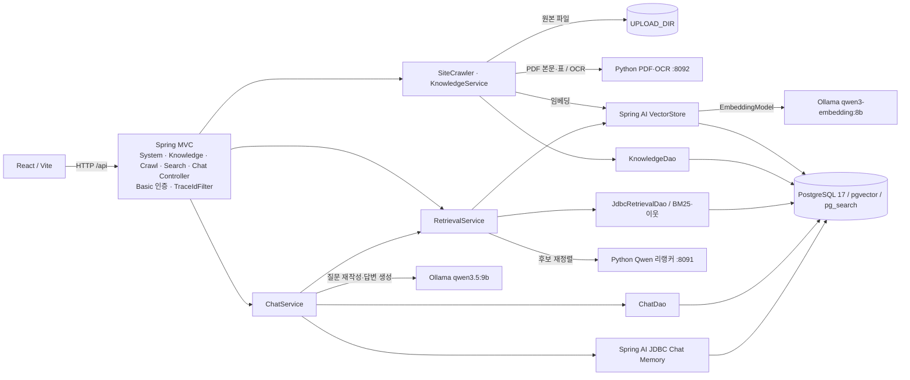

# Spring RAG 아키텍처 (현행 구현)

기준: 2026-10-26 저장소 코드. 이 문서는 실행 중인 구성과 코드 경계를 설명한다. 검색 API와 Ollama 생성 모델을 사용하는 대화 API가 있다.

## 코드와 실행 단위

| 위치 | 역할 |
| --- | --- |
| [`frontend/`](../frontend/) | React 19·TypeScript·Vite 화면. `src/main.tsx`가 로그인, 대화, 문서 목록·업로드·수집 UI와 API 호출을 담당한다. 업로드 상태·완료 알림과 현재 범위의 카테고리별 문서 묶음·필터는 화면 상태로 처리한다. 범위 전환 직후에도 목록은 선택 범위로 제한하며, 관리자의 업로드 카테고리 추천에는 공용 문서의 이름을 사용한다. 개발 서버는 `/api`를 Spring Boot로 프록시한다. |
| [`src/main/java/dev/springrag/`](../src/main/java/dev/springrag/) | Spring Boot 4·Spring AI 2 백엔드. MVC 서버에서 WebFlux `Flux`를 채팅 NDJSON 스트림으로 변환한다. 현재는 저장소 루트 Maven 모듈 안에 `controller`, `dto`, `service`, `dao`, `config`, `infrastructure` 패키지를 둔다. |
| [`infrastructure/`](../infrastructure/) | PostgreSQL/ParadeDB Compose, 로컬 Python PDF 추출·OCR 서버, 로컬 Qwen 리랭커 서버. Compose가 시작하는 서비스는 DB뿐이다. |
| [`evaluation/`](../evaluation/) | 공식 문서 4쪽·16문항 검색 평가. 원시 결과는 Git 제외 `evaluation/results/`에 남긴다. |

`AGENTS.md`의 서비스별 백엔드 패키지 및 `backend/` 모듈은 목표 구조다. 현재 코드가 그 구조로 이동한 것은 아니다. Springdoc OpenAPI 3.0.3이 `/swagger-ui.html`과 `/v3/api-docs`를 제공하며 두 경로에도 HTTP Basic 인증이 필요하다.

컨트롤러는 `SystemController`(상태·로그인 정보), `KnowledgeController`(문서), `CrawlController`(URL 수집), `SearchController`(검색), `ChatController`(대화)로 나뉜다. 각 컨트롤러는 인증 주체와 요청·응답 DTO를 다루며 `ApiExceptionHandler`가 공통 오류 응답을 처리한다. 서비스는 수집·검색·대화 규칙을, DAO는 직접 SQL을 담당한다. 벡터 읽기·쓰기는 예외적으로 서비스가 Spring AI `VectorStore`를 통해 수행한다. Java 외부 HTTP 연동은 `service`의 인터페이스와 `infrastructure`의 구현으로 나뉜다.

## 문서 수집과 색인

1. 관리자의 파일 업로드는 `SHARED`, 사용자의 업로드는 `PRIVATE`로 저장된다. 관리자만 `/api/admin/crawl`로 URL을 수집한다. 크롤러는 시작 URL과 같은 스킴·호스트·경로 하위만 방문하고 최대 100쪽을 동기 처리한다.
2. [`KnowledgeService`](../src/main/java/dev/springrag/service/KnowledgeService.java)가 TXT는 `TextReader`, DOC/DOCX는 Tika, HTML은 JSoup으로 추출한다. HTML에서는 레이아웃 요소와 중첩 텍스트 반복, 동일 제목·본문 절의 중복을 제거한다. PDF는 Python `pdfplumber` 서비스가 머리말·꼬리말을 정리하고 표 행을 Markdown으로 분리한다. 본문과 표 행이 모두 없는 페이지에만 PaddleOCR을 적용한다.
3. 본문은 `TokenTextSplitter`의 700토큰 청크를 기준으로 나누고, 같은 추출 단위 안의 연속 청크에 이전 내용 최대 100토큰을 겹친다. 최종 청크는 최대 800토큰이다. 표 행은 별도 청크로 저장하며 오버랩을 적용하지 않는다. 긴 표 셀은 여러 청크로 나누고, 긴 열 제목은 페이지·표·열마다 한 번만 저장한다. 이후 행의 셀은 같은 열 번호를 표시하며 각 청크는 800토큰 이하다.
4. Ollama `qwen3-embedding:8b`에서 1536차원 벡터를 만들어 `vector_store`에 본문·벡터·메타데이터를 함께 적재한다. `knowledge_document`와 `knowledge_chunk`가 원본 문서 및 청크 ID를 관리한다. 파일 원본은 `UPLOAD_DIR`에 둔다. URL은 원문 SHA-256과 카테고리가 같으면 재색인을 건너뛴다.

공통 청크 메타데이터는 `documentId`, `scope`, `ownerId`, `title`, `source`, `category`, `chunkOrder`, `embeddingModel`이다. HTML에는 `section`, PDF에는 `page_number`·`contentType`, 표 행에는 `tableIndex`·`rowIndex`·`tableExtractionStatus`가 붙는다. 긴 표 제목과 셀 조각에는 `columnIndex`와 `tablePart=HEADER|CELL`도 붙여 같은 열을 연결한다. 적재 실패 시 새 벡터 삭제를 시도하며, 기존 URL 갱신은 문서 ID를 유지하고 청크를 교체한다.

## 검색과 답변

`GET /api/search`의 현재 경로는 아래 순서로 한 질문을 처리한다.

1. `scope=SHARED|PRIVATE`를 검증한다. `PRIVATE` 소유자는 요청 값이 아니라 인증 계정으로 정한다.
2. pgvector 코사인 유사도 **0.3 이상 Top-10**과 `pg_search` BM25 **Top-10**을 각각 조회한다. 벡터 필터와 BM25 SQL 모두 범위·소유권을 제한한다.
3. 청크 ID로 중복을 제거하고 RRF(`k=60`) 상위 10개를 만든다. 로컬 `Qwen/Qwen3-Reranker-0.6B`가 이를 재정렬한다.
4. 재정렬 상위 3개 앵커마다 같은 문서·섹션·페이지·본문 유형의 앞뒤 청크를 조회한다. 표 셀 앵커는 같은 문서·페이지·표·열의 긴 제목 조각도 권한 범위 안에서 조회하고, 질문과 단어가 겹치는 조각을 최대 200토큰 붙인다. 겹친 본문 텍스트를 제거하고 passage당 최대 1,200토큰을 반환한다.

응답에는 `vectorCandidates`, `bm25Candidates`, `candidates`, `reranked`, `passages`가 각각 담긴다. 후보가 없으면 리랭커를 호출하지 않는다. 상세 응답 필드와 오류 형식은 [하이브리드 검색 명세](HybridRetrieval.md)를 따른다.

[`ChatService`](../src/main/java/dev/springrag/service/ChatService.java)는 대화의 소유권·고정 검색 범위를 확인한다. 이전 메시지가 있으면 Ollama `qwen3.5:9b`로 후속 질문을 독립 검색어로 바꾸고, 위 검색의 **최종 passage**만 답변 근거로 보낸다. `MessageChatMemoryAdvisor`와 최대 20메시지 창을 사용한다. 독립 검색 API는 생성 모델을 호출하지 않는다. MultiQueryExpander와 모델 기반 passage 요약은 아직 구현되지 않았다.

채팅의 `/messages/stream`은 Spring AI `ChatClient.stream().content()`의 `Flux`를 NDJSON 이벤트로 내보낸다. React는 출처와 답변 조각을 순서대로 표시하고 `done`을 확인한다. 검색·JDBC 단계는 기존 동기식 경계를 유지하며 완료된 답변만 `chat_message`에 저장한다. `spring-boot-starter-webflux`를 사용해도 웹 서버는 현재 Spring MVC이며, 전체 백엔드가 비차단 WebFlux로 전환된 것은 아니다. 기존 `/messages` JSON 응답은 계속 제공한다.

## 데이터와 권한

| 저장 위치 | 주요 데이터·관계 |
| --- | --- |
| `knowledge_document` | 문서 ID, `SHARED`/`PRIVATE`, 소유자, 출처 URL 또는 저장 경로, 카테고리, 원문 해시, 상태. 공용 문서는 소유자가 없고 개인 문서는 소유자가 필수다. |
| `knowledge_chunk` | 문서 ID ↔ `vector_store` 청크 ID. 문서 삭제 시 카탈로그 관계가 연쇄 삭제된다. |
| `vector_store` | Spring AI 관리 본문·JSON 메타데이터·1536차원 임베딩. HNSW 벡터 인덱스와 ParadeDB BM25 인덱스를 함께 사용한다. |
| `conversation`, `chat_message` | 대화 소유자·범위, 화면용 전체 메시지와 답변 출처 JSON. 대화 범위는 생성 시 고정된다. |
| `spring_ai_chat_memory` | Spring AI JDBC 대화 메모리. `chat_message`와 목적이 다른 별도 저장소다. |
| `UPLOAD_DIR` | 업로드한 파일 원본. URL 수집 원본은 파일로 보관하지 않는다. |

인증은 환경 변수로 주입한 고정 `admin`·`user` 계정과 HTTP Basic으로 처리한다. `/api/health` 외에는 인증이 필요하고 `/api/admin/**`는 관리자만 접근한다. OpenAPI에는 `basicAuth` 보안 스키마와 컨트롤러별 그룹, 상태 코드·파라미터 설명, 공개 DTO 예시를 기록한다. `TraceIdFilter`는 요청 UUID를 MDC와 `X-Trace-Id` 응답 헤더에 넣는다. 검색 서비스의 구조화 로그는 단계별 건수와 소요 시간을 기록한다. 엔드포인트·DTO·오류는 [API 계약](ApiContract.md), 검색·데이터 모델은 [하이브리드 검색 명세](HybridRetrieval.md), 기동·백업·복구는 [운영 런북](../runbooks/SpringRagLocalV0_1_0.md)에 있다.

## 현재 경계

- 프런트엔드는 Vite 개발 서버의 `/api → localhost:8080` 프록시를 사용한다. `?preview`는 화면 샘플 데이터이며 백엔드 응답이 아니다.
- URL 수집은 동기식이며 예약 재수집·작업 큐가 없다. 같은 URL 재수집도 원문 해시와 카테고리가 같으면 기존 색인을 유지한다.
- 다중 질의 확장과 운영용 사용자 관리가 없다. DB Compose 설정과 `application.yml`의 개발용 DB 비밀번호 기본값은 정리 대상이다.
